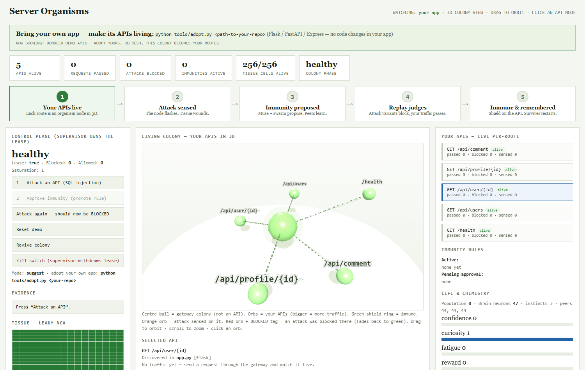
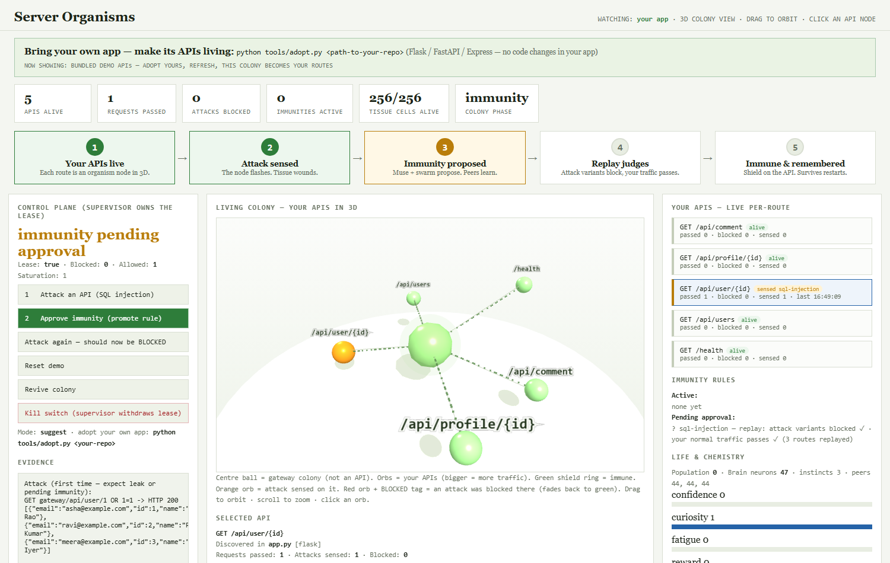
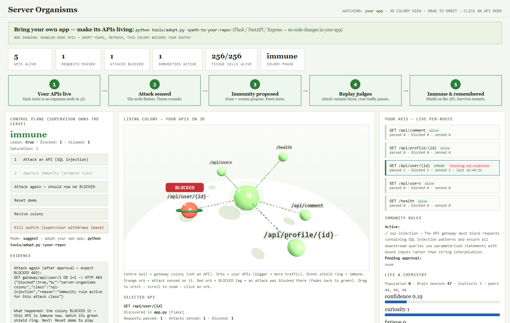

# Server Organisms — Living Immune Layer for Your API


**Not the biggest immune system. The first one that's alive — and yours.**

> **You only need to:** point the colony at your app (one command).
> **You get back:** a living immune layer that blocks exploits per API,
> plus a living 3D world where you watch every API breathe, get attacked,
> and turn immune.

Organisms live between the internet and your API on *your* server. They sense
exploits, wound, propose immunity, prove it by replaying YOUR normal traffic,
promote it, teach their children, and die when you withdraw their lease.
No GPU. No data leaving your host. No code changes in your app.

## See it (60 seconds, zero setup beyond Docker)

```bash
git clone https://github.com/sohan-a11y/server-organisms-v2 && cd server-organisms-v2
python -m organisms demo
```

One command starts the stack, attacks an API, proves immunity by replay,
promotes it, blocks the repeat attack — and prints your private dashboard
link. What you'll see:

| Clean colony — your APIs alive | Attack sensed — immunity pending | Blocked — API immune |
|---|---|---|
|  |  |  |

## Your app, alive in 5 minutes

```bash
python -m organisms init ../your-app --upstream http://host.docker.internal:8000
python -m organisms up
```

`init` scans **your** repo (Flask / FastAPI / Express), discovers every API
route, generates all credentials, and wires the colony in front of your app.
Containerized app? Add `--upstream http://web:8000 --network myapp_default`.

**Watch it working, two ways:**

- **Dashboard (3D):** every API is a living orb — traffic size, attacks
  sensed (orange), blocks (red orb + BLOCKED tag), immunity (green shield
  ring). Click any orb for its live story.
- **Terminal:** `python -m organisms status` (or `--watch`) shows the same
  per-route table; `organisms doctor` diagnoses setup problems;
  `organisms kill` / `revive` are the external kill switch.

## How it works

`Internet -> Gateway Colony (:18010) -> Your API -> DB`.
Supervisor (:18012, separate process the colony cannot modify) owns the
lease, audit log and kill switch. Leaky NCA tissue expresses damage;
endocrine chemistry modulates behaviour; the population metabolizes and
reproduces; the brain grows neurons, learns once from Muse Spark when
unknown, persists across restarts, and teaches peers.

Modes: `suggest` (human approves promotion, default) or `auto`
(replay-PASS promotes itself). Attack classes: SQL injection, broken
authorization, XSS. Promotion is gated by deterministic replay — LLM
opinion never promotes a rule. See [TRUST.md](TRUST.md) and
[docs/MIROFISH_REVIEW.md](docs/MIROFISH_REVIEW.md).

## Demo video

*Recording in progress — the 3-minute hackathon walkthrough will be linked
here (attack → approve → blocked, then adopting a real app).*

## FAQ

**Do I change my app's code?** No. The colony is a reverse proxy in front
of it. Point traffic at the gateway and set `UPSTREAM_URL` to your app.

**Do I need a GPU?** No. NCA tissue, life and brain are CPU-trivial; the
only model calls go to the hosted Meta Model API when the colony meets the
unknown.

**What if the colony is wrong?** Promotion requires a replay proof (attack
variants blocked, your normal traffic passing). In `suggest` mode a human
approves. The supervisor kill switch halts enforcement in seconds.

**Is my data sent anywhere?** Only the teacher calls (unknown attack class
summaries, no user data) leave the host, and only when you set `META_API_KEY`.

## Prior art & novelty

Novel: living enforcement with birth/heredity/mortality, NCA tissue
substrate, local verifier-gated learning, separate-process immune
supervisor. Prior art cited honestly: Darktrace, Cloudflare WAF ML, Salt,
GenProg/DARPA CGC, Mordvintsev NCA + CAX. Product thinking informed by a
`/search-first` review of MiroFish (patterns only, no code — AGPL).

## Tests

`python -m pytest tests/ -q` (19 tests) and the live Docker loop in
`test_live.py` (leak→propose→approve→blocked for SQLi/XSS/broken-auth,
encoded variants, token separation, persistence across gateway and
supervisor restarts, kill switch).

## Safety

Demo upstream (`demo-api/`) is intentionally vulnerable — never deploy it.
The gateway fails open to upstream when the lease is withdrawn (availability
over enforcement), and says so in TRUST.md.
